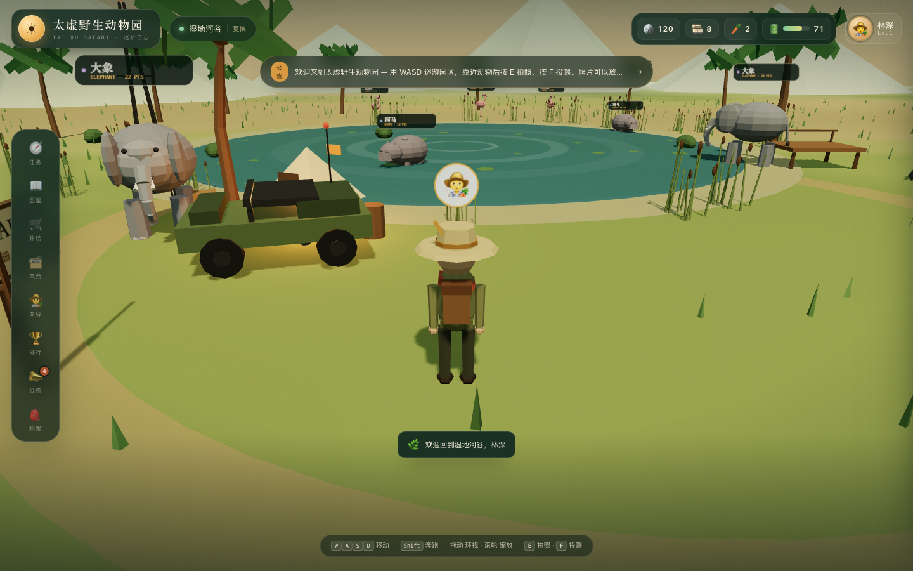

# 太虚野生动物园 · Taixu Safari

一个用 [`taixu`](../taixu) 游戏后端库驱动的 **3D 野生动物园网页游戏**。

你是一名园区巡护员：在金合欢草原或湿地河谷里巡游，用相机拍下动物、投喂它们、
完成巡护任务、集齐图鉴、和电台台长阿宝交易、向向导打听消息，并在摄影积分榜上留下名字。

Rust 后端通过 `axum` 托管 `taixu::Game`；前端是完全程序化生成的低多边形 Three.js 场景，
没有外部美术资源。



---

## 快速开始

```bash
# 需要 Rust 1.75+，并且 taixu 仓库位于 ../taixu
cargo run
# 打开 http://127.0.0.1:3000
```

可选环境变量：

| 变量 | 默认值 | 说明 |
| --- | --- | --- |
| `PORT` | `3000` | HTTP 端口 |
| `TAIXU_SAFARI_STATE` | `data/safari_state.json` | 快照文件路径 |
| `RUST_LOG` | `taixu_safari=info` | 日志过滤 |

**重置世界**：停止服务后删除 `data/safari_state.json`，下次启动会重新播种。
状态每隔 15 秒自动落盘，每次业务操作后也会立即保存。

---

## 操作

| 操作 | 键位 / 方式 |
| --- | --- |
| 移动 | `W` `A` `S` `D` / 方向键 / 移动端虚拟摇杆 |
| 奔跑 | `Shift` / 摇杆推到底 |
| 环视 | 鼠标拖动 |
| 缩放 | 滚轮 |
| 拍照 | `E` 或「拍照」按钮 |
| 投喂 | `F` 或「投喂」按钮 |
| 关闭面板 | `Esc` |
| 面板 | 左侧/底部 dock：任务、图鉴、补给、电台、向导、排行、公告、档案 |

靠近动物到 **12.5 米** 内，底部会出现交互卡片。拍照消耗 1 卷胶片和 5 点相机电量；
投喂消耗 1 份动物零食。胶片、零食和电池都能在营地补给站用金币购买。

---

## 玩法与 taixu 特性的对应关系

| taixu 模块 | 游戏里的表现 |
| --- | --- |
| **Regions** | 金合欢草原 `savanna` 与湿地河谷 `wetland` 两个园区；切换园区会离开当前房间；公告页的管理台可切换 `open / maintenance / closed`，关闭后聊天、购买、交易、接任务、NPC 对话会被拒绝 |
| **Accounts / presence** | 昵称登录、`login / heartbeat / logout`、等级与 XP、在线状态 |
| **Rooms** | 「吉普车电台」与「观鸟塔电台」房间；创建/加入/离开、成员列表、房间聊天 |
| **Friends** | 向阿宝发送好友申请（阿宝自动接受）、解除好友、拉黑/解除拉黑 |
| **Chat** | 系统消息（入岛广播）、区域电台、房间电台、阿宝私聊；私聊里阿宝会自动回信 |
| **Items / Inventory** | 胶片、动物零食、七种动物照片、珍藏地图、湿地望远镜；背包格子与堆叠 |
| **Wallet / Resources** | 金币；相机电量（上限 100，每小时惰性恢复 24 点） |
| **Shop** | 营地补给站：限购、限量库存、仅湿地可买的望远镜、原子扣费 |
| **Trades** | 与阿宝的一笔原子交易：1 张狮子照片 + 30 金币 换「阿宝的珍藏地图」，双方确认后结算 |
| **Cosmetics / Avatar** | 探险帽（角色外观）、金合欢相框、巡护员徽章；头像 emoji 与头衔 |
| **Collections** | 「太虚动物图鉴」11 件条目、4 档里程碑奖励（实时按背包/皮肤/成就计算） |
| **Leaderboards** | 摄影积分榜、投喂榜、向导好感度；并列名次、赛季与管理员重置赛季 |
| **Achievements** | 第一张照片、快门狂人、五兽图鉴、动物之友、隐藏成就「第一次亲密接触」 |
| **Tasks** | 主线/每日/外观任务；metric、item、skin、achievement 四种目标；前置、等级、限时、每日冷却、隐藏任务 |
| **Announcements** | 活动/促销/消息公告；区域定向、优先级、时间窗、未读与已读 |
| **NPC agents** | 两位园区向导（草原/湿地），本地规则 Agent，使用 `Say`、`GiveReward`、`SetScore` 三类动作；礼物 10 分钟冷却由宿主控制 |
| **Persistence** | 自定义 `JsonFileStore` 实现 `GameStore`；启动恢复、周期备份、原子写临时文件后 rename |
| **Config / Clock** | 宿主自定义 `GameConfig`（背包容量、聊天保留数、NPC 上下文条数），使用 `SystemClock`；`ManualClock` 可在测试中注入 |

另外还使用了：`record_event` 同时推进成就与任务、`send_message_with_metadata`、
`send_system_message`、`send_npc_message`、`with_state` 只读查询、`grant_reward` 新手礼包、
`purchased_quantity`、`expire_trades` 后台任务、`reset_leaderboard_season`、
`set_region_status`、`snapshot()` 版本号展示等。

---

## 架构

```
浏览器
  ├─ Three.js 场景（static/scene.js）     程序化地形、水塘/湖泊、动物、角色、相机、音效
  └─ 游戏界面（static/app.js）            HUD、抽屉面板、聊天、轮询、登录
        │  JSON over HTTP（演示鉴权：trusted account_id）
        ▼
Rust 宿主（src/）
  ├─ main.rs        axum + 静态文件、启动恢复/播种、后台交易过期与自动存档
  ├─ api.rs         HTTP 契约、GameError → 协议错误码、聚合 state JSON
  ├─ seed.rs        区域/账号/道具/商店/任务/成就/图鉴/排行/公告/NPC 种子
  ├─ guide.rs       本地 NPC Agent（Say / GiveReward / SetScore + 宿主冷却）
  └─ store.rs       JsonFileStore: GameStore（原子快照落盘）
        │
        ▼
taixu::Game ── parking_lot::RwLock<GameState>
```

几个刻意的设计：

- **taixu 是同步库**：HTTP handler 直接调用门面方法；耗时 I/O（快照落盘）不在锁内。
- **单进程单 Game**：这正是 taixu 的部署模型；宿主负责网络、鉴权、持久化。
- **快照是唯一事实**：启动时有快照就恢复，没有才播种；种子只在首次运行执行。
- **原子性由库保证**：购买、交易结算、任务/成就/图鉴领奖、NPC 回合失败都不会留下半成品。
- **图鉴是实时状态**：把唯一一张狮子照片交易出去，图鉴条目也会随之消失——要不要再拍一张？
  这来自 `CollectionDef` 按当前背包/皮肤/成就实时计算的设计。

### HTTP API

| 方法 | 路径 | 说明 |
| --- | --- | --- |
| POST | `/api/login` | `ensure_account` + 登录 + 新手礼包 |
| POST | `/api/state` | 心跳 + 聚合客户端状态 |
| POST | `/api/photo` | 消耗胶片/电量、发照片、`record_event`、排行榜加分 |
| POST | `/api/feed` | 消耗零食、`feeds` 事件、投喂榜 |
| POST | `/api/task/accept` `/claim` `/abandon` | 任务生命周期 |
| POST | `/api/achievement/claim` | 成就领奖 |
| POST | `/api/collection/claim` | 图鉴里程碑领奖 |
| POST | `/api/shop/buy` | 商城购买（限购/库存/园区） |
| POST | `/api/room/join` `/leave` `/create` | 房间 |
| POST | `/api/chat/send` | 全局/区域/房间/私聊；阿宝私聊自动回复 |
| GET | `/api/chat/messages` | 频道历史 |
| POST | `/api/friend/add` `/remove` `/block` `/unblock` | 好友 |
| POST | `/api/trade/start` `/confirm` `/cancel` | 交易 |
| POST | `/api/npc/chat` | `NpcRuntime::converse` |
| POST | `/api/announcement/read` | 标记已读 |
| POST | `/api/skin/equip` `/unequip` | 外观 |
| POST | `/api/avatar` | 头衔/头像（`update_avatar` 为权威状态） |
| POST | `/api/region/move` | 切换园区 |
| POST | `/api/admin/region-status` | 演示管理台：区域状态 |
| POST | `/api/admin/season-reset` | 演示管理台：排行榜新赛季 |

所有成功响应形如：

```json
{ "ok": true, "state": { "...": "聚合后的客户端状态" }, "result": { "...": "本次操作结果" } }
```

错误统一为：

```json
{ "ok": false, "error": { "code": "INSUFFICIENT_FUNDS", "message": "..." } }
```

---

## 前端技术细节

- 所有动物、树木、吉普车、营地、地形、水面与音效都是程序化生成的，没有图片/模型/字体资源。
- 七种动物各有独立的低多边形模型与游荡 AI；腿部、尾巴、身体起伏有简易动画。
- 拍照会真的截取当前 WebGL 画布，并作为缩略图放进图鉴（本次会话内）。
- 相机使用第三人称轨道跟随；移动、奔跑、水面碰撞、移动端摇杆都已实现。
- 事件音（快门）使用 WebAudio 合成，无音频文件。
- 桌面与移动端布局自适应；移动端提供虚拟摇杆和拍照/投喂按钮。

Three.js 以 MIT 协议引入，版本 r186（`static/vendor/`）。

---

## 注意事项

- **这是演示项目**：`account_id` 由客户端生成并直接信任，没有密码/Token。真实部署时请在网关完成鉴权，
  把可信 `AccountId` 传给 taixu。
- 服务端不校验 3D 距离/视角，拍照与投喂由客户端上报动物种类；真实游戏应把位置/朝向校验放到宿主层。
- 快照包含演示账号（阿宝、米拉、健二）与所有目录/任务/成就配置。修改 `seed.rs` 后请删除旧快照再启动。
- NPC Agent 是本地规则实现，不调用外部模型；`NpcContext::system_prompt()` 可直接接 LLM。
- 交易过期由后台任务每 15 秒调用 `expire_trades()`；taixu 本身不会主动调度。
